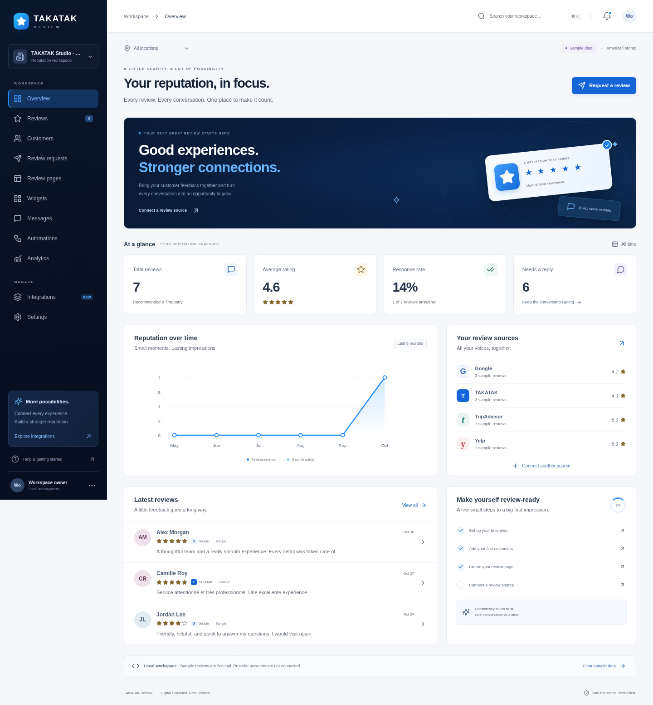

# TAKATAK Review

**Canonical ecosystem integration:** REVEW’s enhancement of the existing master review dashboard is on [takatak-v1 · codex/review-ecosystem](https://github.com/takatakca/takatak-v1/tree/codex/review-ecosystem). Its source CI passed on `8c3cfb8`. This repository retains the standalone reference application, screenshots and [signed integration notes](docs/REVEW-CURRENT-MISSION.md); V1 retains production identity, workspace data, AI credits and billing authority.

TAKATAK's review-management cockpit: one workspace for customer feedback, review sources, replies, invitations, widgets, notifications, and reputation analytics. Implements [issue #2](https://github.com/takatakca/TAKATAKREVIEW/issues/2) and supplies the initial application requested by [issue #1](https://github.com/takatakca/TAKATAKREVIEW/issues/1).



## Run locally

Use Node **22.13 or newer** (Node 22 is pinned in `.nvmrc`).

```sh
npm ci
npm run dev
```

Vite serves the UI on port **5173**, forwarding `/api` to Express on **4100**. Development access is restricted to loopback hosts and connections. No credentials or external services are required for first-party workflows. The workspace starts empty; **Explore sample data** explicitly loads fictional, labeled examples. Sample reviews cannot be published to providers and sample email is never sent.

```sh
npm run build
npm start
```

The built application is served by Express on port **4100**. Use `PORT` to select another port. `var/review.sqlite` stores data durably across restarts. `.env` is optional and ignored by Git; `.env.example` contains configuration names only.

## What works

- Dashboard with actual counts, score distribution, six-month activity, location filtering, source breakdown, and setup checklist.
- Review list, source/rating/response filters, pagination, detail views, first-party public responses, tags, and CSV exports.
- Customer CRUD, selection, consent tracking, validated CSV imports with quoted fields, duplicate handling, and spreadsheet-safe exports.
- Per-location review pages, private invitation links, expiring single-use request completion, all-ratings feedback collection, and explicit publication consent.
- Six iframe widget layouts (carousel, grid, badge, wall, popup, list). Only first-party content with publication consent is exposed publicly.
- Notifications, new-review/low-rating/unanswered-on-arrival rules, email alerts, and durable invitation delivery with idempotent retries. Delivery starts only after an administrator configures a real verified email sender.
- Native Google OAuth with PKCE, encrypted credentials, verified location mapping, complete paginated synchronization, confirmed provider replies, and optional scheduled reads. These are covered with mocked provider tests; live Google access is still required.
- Signed, timestamp-checked, replay-safe provider webhooks and an optional authorized-provider relay contract.
- Documented Yelp empty, recommended/excluded list, reviewer statistics, contact restrictions, photo/permission gates, public-comment detail, and disabled direct-message screens.
- Settings, locations, email templates, signatures, alert preferences, account/usage views, and a handoff to **existing TAKATAK Stripe billing**. Canonical signed module entitlements gate paid provider operations.
- Responsive navigation, keyboard-accessible dialogs, focus states, and automated WCAG AA checks.

## What is deliberately not claimed

Registering a business on a source does not grant management API access. No Google, Yelp, TripAdvisor, Facebook, Trustpilot, email, AI, payment, or production account was connected or charged during development.

Yelp/TripAdvisor/Facebook/Trustpilot management requires an approved provider adapter; unsupported reply actions remain locked. Google and TripAdvisor **interface reference documentation** is still pending from the owner-side sessions mentioned in issue #2; those provider tabs use the shared cockpit rather than claim a verified full interface clone. AI assistance uses the ecosystem's existing approval/credit boundary and is shown as not connected here. Reminder days are a stored preference, not a running reminder campaign. Internal follow-up notes are never described as delivered direct messages. English UI is implemented; a content-language preference is stored without claiming full French localization.

Do not use this standalone cockpit as a second identity, tenant directory, or billing authority. See [integration contracts](docs/INTEGRATIONS.md), [requirements and implementation matrix](docs/IMPLEMENTATION.md), [deployment](docs/DEPLOYMENT.md), and [signed work notes](WORKLOG.md).

## Validate

```sh
npm test                  # API, persistence, tenant isolation, delivery, OAuth and provider tests
npm run build             # production bundle; no remote font/build downloads
npx playwright install chromium # only if no browser is already installed
npm run test:e2e          # browser workflow, Yelp gates, mobile, navigation and WCAG AA
npm run format:check
```

The browser tests use a fresh in-memory server and synthetic data. System Chromium is used when present; set `CHROMIUM_PATH` or use Playwright's installed browser otherwise. Tests do not contact external providers. GitHub Actions runs the same build and test commands.

## Reference integrity

The committed [Yelp observation](docs/spec-interface-yelp-reviews-reference.md) is preserved unchanged. It records third-party interface observations, not authority to log in, send messages, solicit Yelp reviews, purchase upgrades, or copy source customer data. The uploaded `OK.zip` supplied 66 screenshot references; no screenshots, keys, customer records, or private account details were embedded into the application. The UI uses the TAKATAK palette and a text wordmark with a generic product icon; it does not redraw the official corporate logo.

— Codex, 2026-10-31
